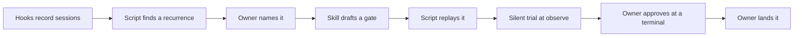

# kh-harness

A Claude Code plugin and five small Node scripts that inspect a repository,
propose only the agent harness it is missing, write it when you say so, and
remove it again cleanly.

[](CHANGELOG.md)
[](package.json)
[](package.json)
[](.claude-plugin/plugin.json)
[](https://github.com/angkoonhian/kh-harness/actions/workflows/ci.yml)

For a developer who already has a repository and uses Claude Code in it.
`detect` reports what the repository has and what it lacks, with the
evidence it read. `apply` writes only what that report proposed, as a dry run
until you add `--yes`. `uninstall` removes exactly what `apply` wrote. Once
installed, the harness can also keep a log of your sessions on your machine
and turn a tool failure that recurs into a small gate, which takes effect
only when you approve it.

**What you get**

- **A capability report** — `docs/harness/detect.json`, each check
  `verified`, `declared`, `absent`, `failing` or `n/a`, with its evidence.
- **A lint sensor** — your package's own `lint` script, on each file Claude
  edits.
- **A stop gate** — your root `typecheck` or `test` script at the end of
  each turn.
- **A session brief and a handoff file** — the top of `HANDOFF.md` at each
  session start.
- **A rules registry and a rules brief** — `docs/harness/RULES.md`,
  re-stated on every prompt once it holds a rule.
- **A loop warning** — one sentence when the same call fails the same way
  three times in a row.
- **A session log** — every session, on your machine, outside the
  repository, once you enable it.
- **A failure taxonomy** — `docs/harness/FAILURES.md`, where you name what
  recurs.
- **A gate hook** — learned gates on tool calls, with deny rules that
  protect it.
- **An integrity check** — kit files against the manifest, and each
  committed gate against its approval.

## Contents

- [Quick start](#quick-start)
- [How it works](#how-it-works)
- [Commands](#commands)
- [Turning on the session log and the learning loop](#turning-on-the-session-log-and-the-learning-loop)
- [What it stores and what it never stores](#what-it-stores-and-what-it-never-stores)
- [Limits](#limits)
- [Documentation](#documentation)
- [Requirements and exit codes](#requirements-and-exit-codes)

## Quick start

The output below was captured on 2026-11-19 on Windows, from a scratch
repository with a `package.json` declaring `lint` and `test` scripts. It is
trimmed where marked `…`. `<kh-harness>` is where you cloned this
repository.

**1. Install the plugin.** From the root of your kh-harness checkout:

```sh
claude plugin marketplace add ./
claude plugin install kh-harness@kh-harness-local
```

Only `./` works; `claude plugin marketplace add .` is rejected with
`Invalid marketplace source format`. `claude plugin list` then lists
`kh-harness@kh-harness-local`, with `Read from:` naming your checkout: a
folder marketplace reads from the working tree, so it is not a copy. The
plugin ships two skills, `harness-init` and `harness-learn`, and declares no
hooks. In the repository you want harnessed, `/harness-init` walks you
through the steps below. You can also run the scripts yourself.

> [!WARNING]
> **Before you run `apply --yes` anywhere: it can install hooks that execute
> this repository's own `lint`, `typecheck` or `test` scripts
> automatically**: the package's `lint` script after each edit, and the root
> `typecheck` (or `test`) script, over the whole repository, at the end of
> each turn. A `git pull` that changes those scripts changes what runs by
> itself. On a large codebase the stop gate can add 10–30 s per turn. The
> plugin installs none of this; `apply` writes the hooks into your
> repository when you ask it to.

**2. Inventory the repository.** From the repository, on a branch:

```sh
git switch -c harness
node <kh-harness>/scripts/detect.mjs .
```

```
kh-harness 0.2.0 — task-36-demo
profile: typescript-single   branch: harness

Phase 0 — Reconnaissance
  [x] P0.inventory       verified
  [x] P0.security        verified
  [ ] P0.recon           absent
      → run the recon prompt to write docs/harness/recon.md (the skill drafts this; apply does not write it)
…
  [ ] P2.sensor          absent
      → install scripts/lint-touched.mjs and register a PostToolUse hook
  [ ] P2.stopgate        absent
      → install scripts/verify-touched.mjs and register a Stop hook
…
14 proposals: 9 apply can write, 4 for the skill to draft, 1 for a human. Nothing has been written except docs/harness/detect.json.
```

`detect` writes only `docs/harness/detect.json`.

**3. Read what `apply` would write.** Without `--yes` nothing is written:

```sh
node <kh-harness>/scripts/apply.mjs .
```

```
kh-harness: 35 actions to close 9 capability gaps for <repo>

--- docs/harness/RULES.md  [P3.rules]
    no rules registry found
…
--- .claude/settings.json (hook: PostToolUse)  [P2.sensor]
…
WHAT THE HOOKS EXECUTE — read this before running `apply`
  Installing the two process hooks means THIS REPOSITORY'S OWN SCRIPTS ARE RUN
  AUTOMATICALLY, by Claude Code, without being asked each time:
…
Dry run — nothing written. Re-run with --yes to apply.
```

Read the disclosure the dry run prints, `WHAT THE HOOKS EXECUTE`, before
you continue.

**4. Write it.**

```sh
node <kh-harness>/scripts/apply.mjs . --yes
git status --short
```

```
…
wrote      docs/harness/RULES.md
wrote      docs/harness/FAILURES.md
wrote      .claude/scripts/session-log.mjs
…
patched    .claude/settings.json (permissions.deny)
patched    .claude/settings.json (PostToolUse)
…
?? .claude/
?? HANDOFF.md
?? docs/
```

`--yes` prints the proposals again before one line per action. On the
default branch it refuses (exit 3) unless you add `--allow-default-branch`;
with uncommitted changes to tracked files it refuses unless you add
`--allow-dirty`. Review with `git diff` and commit. A second `detect` now
reports the installed checks as `declared`.

**5. Undo it, if you want to.**

```sh
node <kh-harness>/scripts/uninstall.mjs .         # what it would remove
node <kh-harness>/scripts/uninstall.mjs . --yes
```

```
Will remove:
  docs/harness/RULES.md
  .claude/scripts/session-log.mjs
…
Will keep:
  docs/harness/FAILURES.md (ours-modified)
…
Will keep this machine's session log for this repository (data, outside the repository — uninstall never removes it):
  <data> (34574 bytes)
…
Removed:
  docs/harness/RULES.md
…
Kept:
  docs/harness/FAILURES.md (ours-modified)
```

A file you edited is kept and named, and then the manifest is kept with it.
The session log is never removed by `uninstall`; `log purge --yes` removes
it.

## How it works

### Setting up the harness


1. `detect` reads the repository and writes `docs/harness/detect.json`:
   each check's state and the evidence it read.
2. Each `absent` check that can be decided carries a proposal. One that
   cannot be decided asks a question instead of guessing.
3. `apply` shows every proposal as a diff and writes nothing until you add
   `--yes`.
4. With `--yes` it writes inside a write allowlist enforced in code, never
   over a file it did not write, and records each write in
   `.claude/kh-harness.manifest.json` by content hash.
5. `uninstall` removes a file only when the manifest records it, its content
   is unchanged and it carries the kit's stamp.

### The learning loop



1. The hooks record each session, once you enable the log.
2. Plain code finds a recurrence: the same failing tool call in two or more
   sessions under the same kit hooks and model.
3. You name it in `docs/harness/FAILURES.md`.
4. The `harness-learn` skill drafts one gate for it.
5. The script replays the gate against the log. A model never reports the
   result.
6. A gate that passes runs at `observe`: it records each firing and blocks
   nothing.
7. You approve its hash at a standalone terminal, for `warn` or `block` on
   this machine, or a policy you recorded there promotes it.
8. You land it in the repository, where it binds everyone once committed.

## Commands

| Command | What it does | Writes |
|---|---|---|
| [`detect`](docs/guide/commands.md#detect) | Inventories the repository and reports each capability with its evidence | `docs/harness/detect.json` only |
| [`apply`](docs/guide/commands.md#apply) | Writes what `detect` proposed; a dry run without `--yes` | the repository, with `--yes` |
| [`uninstall`](docs/guide/commands.md#uninstall) | Removes what `apply` wrote, and nothing else; a dry run without `--yes` | the repository, with `--yes` |
| [`log`](docs/guide/commands.md#log) | The session log for one repository on this machine | the data directory |
| [`learn`](docs/guide/commands.md#learn) | The learnings for one repository on this machine | the data directory; `land` and `revert` also the repository |

Each takes `--help` for its full contract. The flags of the first three:

| Command | Flag | What it does |
|---|---|---|
| `detect` | `--verify` | Runs the test, lint and typecheck commands it found. **This executes the repository's own commands.** |
| `detect` | `--json` | Prints the full report on stdout instead of the summary. |
| `apply`, `uninstall` | `--yes` | Actually write or remove; without it, a dry run. |
| `apply` | `--allow-dirty` | Proceed with uncommitted changes to tracked files. |
| `apply` | `--allow-default-branch` | Proceed on the default branch. |

### `log`

| Subcommand | What it does | Writes | Standalone terminal |
|---|---|---|---|
| [`enable`](docs/guide/commands.md#log-enable) | Turns the log on for this repository on this machine | data directory | no |
| [`disable`](docs/guide/commands.md#log-disable) | Turns it off; what it holds is kept | data directory | no |
| [`status`](docs/guide/commands.md#log-status) | What the log holds and whether it can be trusted | no | no |
| [`report`](docs/guide/commands.md#log-report) | Recurring failures and how each gate fired | no | no |
| [`maintain`](docs/guide/commands.md#log-maintain) | Seals and expires what the session-start hook did not reach | data directory | no |
| [`purge`](docs/guide/commands.md#log-purge) | Lists, or with `--yes` removes, the whole data directory | data directory, with `--yes` | no |

### `learn`

| Subcommand | What it does | Writes | Standalone terminal |
|---|---|---|---|
| [`candidates`](docs/guide/commands.md#learn-candidates) | Recurrences no learning stands for | no | no |
| [`evidence`](docs/guide/commands.md#learn-evidence) | The recorded calls behind one recurrence | no | no |
| [`draft`](docs/guide/commands.md#learn-draft) | Stores a drafted gate and replays it | data directory | no |
| [`replay`](docs/guide/commands.md#learn-replay) | Replays a candidate again | data directory | no |
| [`list`](docs/guide/commands.md#learn-list) | Every learning, its status and the approvals | no | no |
| [`show`](docs/guide/commands.md#learn-show) | One learning, its gate and its hash | no | no |
| [`approve`](docs/guide/commands.md#learn-approve) | Promotes a gate on trial to `warn` or `block` on this machine | data directory | **yes** |
| [`wrong`](docs/guide/commands.md#learn-wrong) | Marks one recorded firing wrong | data directory | **yes** |
| [`demote`](docs/guide/commands.md#learn-demote) | Takes a gate back to `observe`, or suspends a landed one here | data directory | **yes** |
| [`retire`](docs/guide/commands.md#learn-retire) | Ends a learning; refused while its gate is still committed | data directory | **yes** |
| [`tick`](docs/guide/commands.md#learn-tick) | Runs the unattended rules once | data directory | no |
| [`land`](docs/guide/commands.md#learn-land) | Writes a promoted learning into the repository, uncommitted; the dry run writes nothing | repository and data directory, with `--yes` | **yes**, for `--yes` |
| [`revert`](docs/guide/commands.md#learn-revert) | Takes a learning's gate, entry and record out of the repository, from whatever is left | repository and data directory, with `--yes` | **yes**, for `--yes` |
| [`policy show`](docs/guide/commands.md#learn-policy-show) | The policy and what `tick` will promote | no | no |
| [`policy set`](docs/guide/commands.md#learn-policy-set) | Sets the promotion policy and records its hash | data directory | **yes** |
| [`policy clear`](docs/guide/commands.md#learn-policy-clear) | Withdraws the policy | data directory | **yes** |

> [!IMPORTANT]
> A **standalone terminal** means a person at an interactive terminal
> outside Claude Code: standard input and output are both terminals and
> `CLAUDECODE` is unset. An IDE's built-in terminal sets `CLAUDECODE` too
> and is refused. Anywhere else these subcommands exit 3 and change nothing.
> This is how the agent is kept from approving its own work. The eight
> owner-only subcommands are `approve`, `wrong`, `demote`, `retire`, `land`,
> `revert`, `policy set` and `policy clear`; `apply`'s deny rules make Claude
> Code decline all eight, the dry runs of `land` and `revert` included. The
> `harness-learn` skill runs none of them, nor `policy show`.

## Turning on the session log and the learning loop

Once `apply` has installed the session-log and gate hooks:

1. **You** turn the log on, from the repository:

   ```sh
   node <kh-harness>/scripts/log.mjs . enable
   ```

   ```
   The session log is enabled for <repo> on this machine.
     kept at: <data>
   …
   Credentials are masked before anything is written, on a best-effort basis: some may be missed, so treat the log as able to hold a secret.
   ```

2. **The hooks** record each session while you work normally.

3. **You** read what recurs, after a few sessions:

   ```sh
   node <kh-harness>/scripts/log.mjs . report
   ```

   ```
   RECURRENCES (the same failure in two or more sessions under one harness and model)
     harness 327164425d96edf6f4693e61c4beb79d25cab9673231adbd20754486febb1926, model claude-opus-5
       23bdd7aaf71db0a4  Bash: in 2 sessions, 2 times, from 2026-11-19T15:30:54.672Z to 2026-11-19T15:30:55.737Z
         error: npm error Unknown command: "tset"
         failure kind: unlabelled
   …
   This report counts recurrences and gate firings in the sessions read; it does not show that outcomes improved.
   ```

4. **You** name the failure in `docs/harness/FAILURES.md`, below the
   comment:

   ```markdown
   ## F1 — npm script name mistyped
   - signatures: 23bdd7aaf71db0a4
   ```

5. **The `harness-learn` skill** drafts. Invoke it, or let the model invoke
   it. It runs `learn candidates`, `learn evidence`, then `learn draft`,
   which replays the gate:

   ```
   draft: stored as L1, a candidate; gate sha256 9327307647ec4a358468fcb9e90fe0fa1b77a08c9f9fc82f12039a048e496f0d
   replay: pass: "the gate fired on all 2 mistakes, on none of 2 successful calls that followed them, and on none of 24 calls of the gate's tool in 2 sessions with no failure of this signature"
   status: trial; its gate is in this machine's local gate set at observe, where it blocks nothing. Show it, then approve it at a terminal, to promote it
   ```

   On a fresh log the verdict is usually `not-checkable`: the replay needs
   at least 20 clean calls of the gate's tool across 2 sessions. A
   recurrence whose draft the replay rejected, or another labelled with the
   same failure kind, is drafted again only with `learn draft --redraft`,
   which the skill passes only when you ask for a new draft in the
   conversation.

6. **The gate hook** runs the gate at `observe` and records each firing.
   **`tick`**, run by you or the skill, repairs, demotes and promotes under
   your policy; it never runs by itself.

7. **You** read the learning:

   ```sh
   node <kh-harness>/scripts/learn.mjs . list
   node <kh-harness>/scripts/learn.mjs . show L1
   ```

8. **You** approve it, in a standalone terminal, with the hash `show`
   printed:

   ```sh
   node <kh-harness>/scripts/learn.mjs . approve L1 --sha256 <hash> --action block
   ```

   From Claude Code, or any non-terminal, it refuses:

   ```
   kh-harness: approve refused: standard input is not an interactive terminal; it needs a person at an interactive terminal outside Claude Code, and nothing was changed.
   ```

9. **You** land it, on a branch. First the dry run, which needs no terminal
   and writes nothing; it prints its notes and the diff:

   ```sh
   node <kh-harness>/scripts/learn.mjs . land L1
   ```

   In the scratch run behind this page `L1` had not been approved — that
   needs a person at a terminal — so the dry run refused it (exit 3):

   ```
   kh-harness: land: L1 is trial; only a learning promoted on this machine is landed
   ```

   Once approved, write it from a standalone terminal:

   ```sh
   node <kh-harness>/scripts/learn.mjs . land L1 --yes
   ```

   It writes `docs/harness/LEARNED.md`, `.claude/kh-harness/gates.json` and
   the manifest, and ends: `The change is not committed: review what this
   run changed with git status and git diff, and commit it; until then it
   reaches no one else.` Commit it.

To take a learning back, use `wrong`, `demote`, `revert` or `retire`; see
[The learning loop](docs/guide/learning-loop.md).

## What it stores and what it never stores

The log lives in `~/.claude/kh-harness/<key>/` (or under `KH_DATA_DIR`),
never in the repository. Once enabled, it stores:

- each event's ids and times, and which kit hooks and model were in force;
- each prompt you type;
- each tool call's input and output, after a best-effort credential scrub;
- the first line of each error.

It never stores the agent's own account of its work (its last message, a
compaction summary), the input of a pre-tool event beyond its hash, or a
transcript's contents. While disabled, it stores nothing. Content is kept
90 days; structure is kept until you purge. Full detail, what the scrub
misses, and the cost figures are on [The session log](docs/guide/session-log.md).

## Limits

> [!WARNING]
> These controls run on one user account. **They are detection and deny
> rules, not isolation**: anything the agent can run as you, it can use to
> undo them.

- An agent with a shell can append a syntactically valid line to the
  ledger, including a forged approval or forged wrong marks. The hash chain
  makes such a line permanent and visible in `learn list` and `log status`;
  it does not make it impossible.
- One line of junk in the ledger breaks its chain. While it is broken,
  every learned gate in this machine's gate file is removed at the next
  `learn` step that writes, none is restored, and nothing is promoted.
  There is no command that repairs the ledger.
- An agent can write `gates.local.json` directly, and the gate hook enforces
  what it holds. `tick`, or the next `learn` command that writes, removes
  every gate the ledger does not vouch for; until then the forged gate acts.
- The firing counts a policy relies on come from the session log, which the
  same user can append to. Forged firings can satisfy a policy. Your
  approval of a hash at a terminal is the only control that does not depend
  on the log.
- The kit's internal functions can be called from Node with a made-up
  terminal result. The terminal check guards the command line, not the
  library.
- A process running as you can also forge a terminal and clear
  `CLAUDECODE`.
- The deny rules match the text `learn.mjs` followed, after a space, by a
  subcommand word, in the Bash and PowerShell tools. A command that reaches
  the script another way, through a package script or with the subcommand
  quoted, is not caught by them, and only the terminal check stops it. An
  unrelated command that holds that text, such as a commit message, is
  declined too.
- The deny rules cover `land` and `revert` whole, so Claude Code also
  declines an agent's dry run of either, by design: the dry run is yours to
  read.
- A dry run of `land` or `revert` writes nothing in the repository or the
  data directory, but the `git status` it runs for the dirty-tree check may
  refresh `.git/index`, as git does.
- The deny rules on the protected paths stop Claude Code's file tools and
  the shell file commands it recognises. A program the agent runs that
  writes those files itself is not caught. The data-directory rule covers
  `~/.claude/kh-harness/` only; a data directory moved with `KH_DATA_DIR`
  needs a rule you add yourself.
- `log enable`, `log disable`, `log maintain` and `log purge --yes` need no
  terminal and are not denied. `log purge --yes` deletes the ledger, the
  learnings and the policy with the log.
- A fresh log returns `not-checkable` for most drafts until it holds at
  least 20 clean calls of the gate's tool across 2 sessions.
- After a branch switch to a checkout without a committed gate, or once an
  uncommitted land is discarded, a landed learning is enforced nowhere until
  the next `learn` command or `tick`.
- A session is sealed only after 10 minutes without a new event, and
  `log maintain` waits for that too. Until then those events are checked by
  nothing, and `log status` says so ("events not yet sealed, in N sessions,
  are not checked").
- The harness identity is checked once per prompt. Tool events after a
  mid-turn edit to an installed hook are attributed to the previous base
  until the next prompt.
- A `warn` gate's message reaches the model after the call has run; only
  `block` stops a call.
- The credential scrub is best-effort; see
  [what the scrub misses](docs/guide/session-log.md#the-credential-scrub-and-what-it-misses).
  The log will at some point hold a secret.

Nothing here claims that the harness or an agent improved. The commands
report counts: recurrences, replays, firings and what followed them.

## Documentation

| Page | What it covers |
|---|---|
| [Command reference](docs/guide/commands.md) | Every command, subcommand and flag, with real output |
| [The session log](docs/guide/session-log.md) | What is stored and where, the scrub, retention, sealing, cost |
| [The learning loop](docs/guide/learning-loop.md) | States of a learning, replay, policy, landing, reverting, recovery |
| [Troubleshooting](docs/guide/troubleshooting.md) | Each refusal and notice, and what ends it |
| [Intent](docs/INTENT.md) | What the kit is for, its success and failure tests, its non-goals |
| [Rules](docs/harness/RULES.md) | The kit's own rules registry, each rule with its enforcer |
| [Session log and learning loop design](docs/superpowers/specs/2026-11-19-session-log-and-learning-loop-design.md) | The design, and where the build differs from it |
| [Audit, 2026-11-18](docs/2026-11-18-audit-findings.md) | The audit this release's fixes answer |
| [Changelog](CHANGELOG.md) | What changed in each release |

### Development

    npm test

The suite needs no network. **The eval suite cannot measure
`harness-init`:** its `disable-model-invocation: true` keeps it out of the
model's context, and `claude plugin eval` passes prompts verbatim, so a
literal `/harness-init` is inert text. Two CI runs reported `meanDelta: 0`
for that reason, not because the plugin makes no difference. No eval case
exists for `harness-learn`. The CI `eval` job runs only on
`workflow_dispatch`, and shows as skipped, never passed, without a
credential.

## Requirements and exit codes

| Requirement | |
|---|---|
| Node | 22 or later; CI runs 22 and 24 on Linux and Windows |
| Dependencies | none at run time |
| Claude Code | to use the plugin, the hooks and the skills; the scripts run without it |
| git | for `apply`'s branch and dirty-tree refusals |

| Exit code | Meaning |
|---|---|
| `0` | did what it said |
| `2` | could not act: a bad path or argument, unreadable settings, a failed write or removal, a `learn` step that was refused or could not finish |
| `3` | refused to act: the default branch, a dirty tree, a corrupt or missing manifest, a terminal-only subcommand without a person at a terminal |

Nothing is sent anywhere. Nothing else is an exit code; a crash is a bug.
