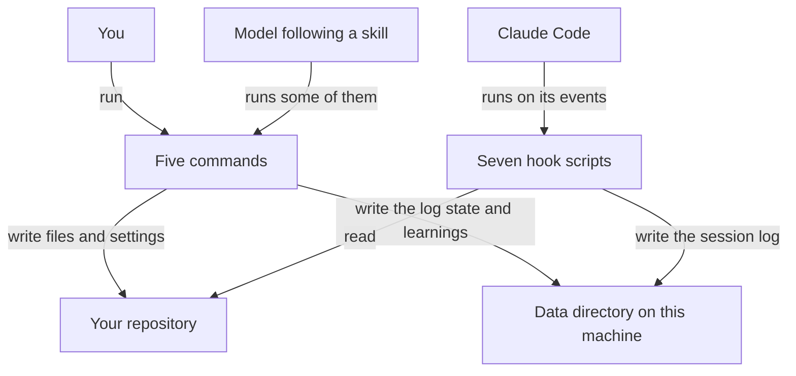
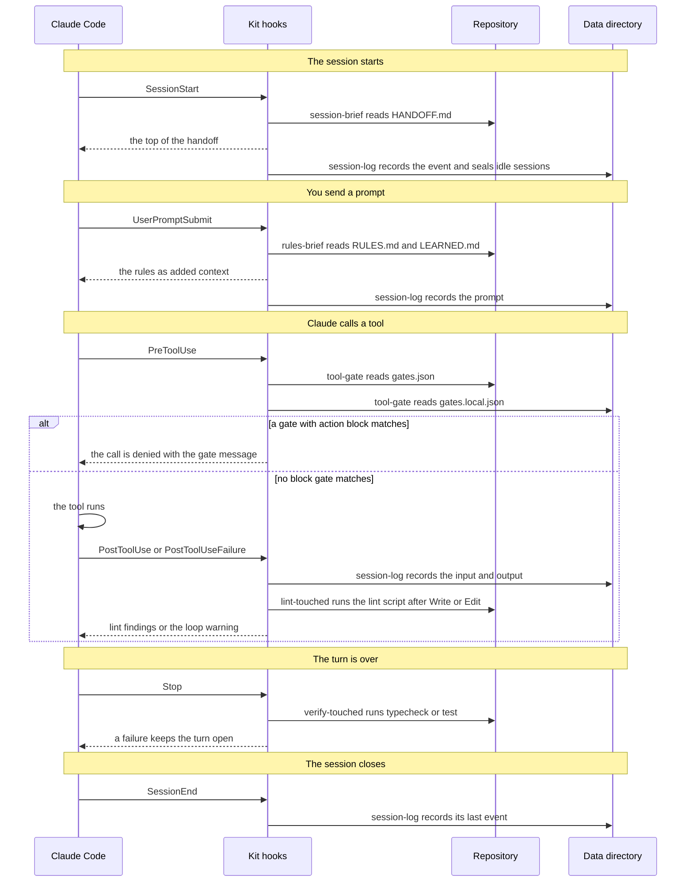
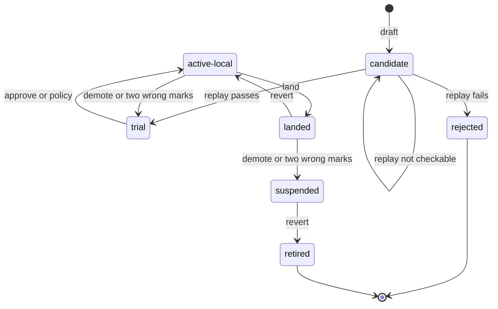

# How kh-harness works

The machinery, for someone who wants to understand it before trusting it:
what the parts are, what runs at each moment of a Claude Code session, where
every file lives, and how each decision is made. This page explains; it is
not a command reference. Each section links to the page that holds the
detail.

[Back to the README](../../README.md) ·
[Command reference](commands.md) ·
[Session log](session-log.md) ·
[Learning loop](learning-loop.md) ·
[Troubleshooting](troubleshooting.md)

## Contents

- [The pieces](#the-pieces)
- [What runs when](#what-runs-when)
- [Where everything lives](#where-everything-lives)
- [How detect decides](#how-detect-decides)
- [How apply and uninstall stay safe](#how-apply-and-uninstall-stay-safe)
- [How a failure becomes a gate](#how-a-failure-becomes-a-gate)
- [What the guarantees are, and are not](#what-the-guarantees-are-and-are-not)

## The pieces

There are three kinds of part, and they are run by three different things.



### The five commands

Each is a Node script in this repository's `scripts/` directory, with no
dependency to install. You give it the repository to work on.

| Command | In one line |
|---|---|
| `detect` | reads the repository and writes a report of what it has and lacks |
| `apply` | writes what the report proposed; a dry run until you add `--yes` |
| `uninstall` | removes what the manifest records as written by the kit |
| `log` | manages the session log for one repository on this machine |
| `learn` | manages the learnings: gates drafted from failures in that log |

Their flags, output and exit codes are in the
[command reference](commands.md).

### The plugin and its two skills

`.claude-plugin/plugin.json` makes this repository a Claude Code plugin.
The plugin ships two skills and one hook, so installing it changes nothing
in any repository. The hook, `scripts/session-nudge.mjs` on `SessionStart`,
runs in every session and only tells the session one thing: whether the
repository has no harness, an older or newer one, or a manifest that can't
be read. It is silent when the harness is at the plugin's version, outside
a git repository, in kh-harness itself, and after
`git config kh-harness.nudge off` (one repository) or `KH_HARNESS_NUDGE=off`
(everywhere). It writes nothing. When it tells Claude to offer
`/kh-harness:harness-init`, it also tells Claude to install only if you
agree.

The same hook keeps the plugin itself current. It starts
`scripts/self-update.mjs` in the background, which fetches the plugin
checkout's upstream at most once an hour and fast-forwards to it. It
leaves the checkout as it is when the checkout has tracked changes,
commits of its own, a detached HEAD or no upstream. The next session
is told the outcome once. `KH_HARNESS_AUTO_UPDATE=off` turns it off.
The logic is in `scripts/lib/self-update.mjs`.

It is a separate script from every hook `apply` installs. Claude Code adds
a plugin's hooks to a repository's without removing duplicates, so a
plugin copy of an installed hook would run twice in every harnessed
repository.

A **skill** is a Markdown file of instructions that Claude Code puts in
front of the model. A **script** is code. The difference matters here:

- Nothing checks that a model followed a skill's text. A skill can ask the
  model to stop and wait for you; it cannot make it.
- A script's checks are code: they run each time the script runs.

| Skill | How it starts | What the model does under it |
|---|---|---|
| `harness-init` | only when you type `/harness-init` | runs `detect`, shows you the report and `apply`'s dry run, and is told to stop at the end of each phase until you answer, and to pass `--yes` only after you confirm |
| `harness-learn` | when you invoke it, or when the model does | runs the reading and drafting subcommands of `log` and `learn`, and reports what they counted |

The kit is built so that code decides and the model drafts:

- In setup, `detect` and `apply` are code: what they propose and write
  comes from what `detect` read. The model drafts the four documents that
  need judgement and writes them itself, each shown to you at a stop:
  `docs/harness/recon.md`, `docs/harness/CLAUDE.proposed.md`,
  `docs/ARCHITECTURE.md` and `docs/INTENT.md`. No script writes
  `CLAUDE.md`, and the skill tells the model not to.
- In the learning loop, the model writes one draft as a JSON file. The
  `learn draft` command validates it, stores it and replays it against the
  log. The `learn` commands compute the verdict, record every status
  change and write the gate files.

### The hook scripts

A **hook** is a command Claude Code runs by itself when an event happens in
a session, such as a prompt being sent or a tool being called. `apply`
copies up to seven hook scripts, three entry scripts and the six modules
they load, from this repository's `assets/scripts/` into your repository's
`.claude/scripts/`, and registers them in `.claude/settings.json`. Each
copy is the asset plus one stamp line. The plugin installs none of them;
only `apply --yes` does.

Each is registered as `node` plus the script's path under
`${CLAUDE_PROJECT_DIR}`, so Claude Code starts it without a shell. On the
three tool-call events, the two hooks of the event are registered once,
together, as that event's entry script; see
[the entry scripts](#the-entry-scripts).

## What runs when

### Each hook script

| Script | Event it is registered on | Proposed when | What it reads | What it writes or prints | Can it block? |
|---|---|---|---|---|---|
| `session-brief.mjs` | `SessionStart` | always | `HANDOFF.md`, or `docs/HANDOFF.md` | prints the top of that file into the session, after the credential mask, bounded in lines and bytes; writes nothing | no |
| `rules-brief.mjs` | `UserPromptSubmit` | once `docs/harness/RULES.md` and `docs/harness/LEARNED.md` hold at least one rule to add | those two files | adds up to 1,500 bytes of their rules to the prompt's context | no |
| `tool-gate.mjs` | `PreToolUse`, for every tool, through `dispatch-pre-tool.mjs` | always | the committed `.claude/kh-harness/gates.json` and this machine's `gates.local.json` | a denial or a message when a gate matches; a `gate_firing` line in the session log while the log is enabled | **yes**: a matching gate with action `block` denies the call |
| `lint-touched.mjs` | `PostToolUse`, through `dispatch-post-tool.mjs`; it acts after `Write` and `Edit` only | a package declares a `lint` script | the edited file's path, and the `package.json` of the package that owns it (for a `.py` file, `pyproject.toml`) | **runs the owning package's `lint` script**, bounded at 30 s; gives Claude the findings that name the edited file | no: the edit has already happened |
| `loop-watch.mjs` | `PostToolUseFailure`, through `dispatch-tool-failure.mjs` | always | the failed call's tool name, input and first error line | keeps a hash of them per session; adds one fixed sentence at the third identical failure with no different failure between | no |
| `verify-touched.mjs` | `Stop` | the root package declares a `typecheck` or `test` script | the root `package.json`, and `git status` | **runs the root `typecheck` script, or `test` when there is none**, bounded at 120 s; on a failure, gives Claude the output, after the credential mask and bounded | **yes**: a failure different from the last one it reported stops the turn from ending, at most 3 times between passing runs |
| `session-log.mjs` | 16 events, listed below; on a tool-call event, through its entry script where there is one | always | the event Claude Code hands it | nothing until you run `log enable`; then one line per event in the data directory | no: it always exits 0 |

The 16 events `session-log.mjs` is registered on are `SessionStart`,
`UserPromptSubmit`, `PreToolUse`, `PermissionRequest`, `PermissionDenied`,
`PostToolUse`, `PostToolUseFailure`, `SubagentStart`, `SubagentStop`,
`Stop`, `StopFailure`, `InstructionsLoaded`, `PreCompact`, `PostCompact`,
`PostModelSwitch` and `SessionEnd`.

Notes on the table:

- Two scripts run your repository's own commands: `lint-touched.mjs` and
  `verify-touched.mjs`. The other five run no script of the repository's.
  Only the `PreToolUse` entry script loads repository code: each module
  another plugin lists in `.claude/kh-harness/extensions.json`, one
  self-contained file under `.claude/` run only when its bytes match the
  hash recorded for it, which can block the call. kh-harness never writes
  that file.
- On the three tool-call events the kit's two hooks run one after the
  other, always in the same order: before a call, the gate hook and then
  the session log; after a call, the session log and then the lint
  sensor; after a failed call, the session log and then the loop warning.
  On `SessionStart`, `UserPromptSubmit` and `Stop`, where the session log
  sits beside another kit hook, each is its own registration and its own
  process, and no order between the two is promised.
- The six modules are loaded by the scripts above and registered on no
  event: `harness-redact.mjs` (the credential mask, shared paths, bounded
  runner), `harness-log.mjs` (where the data directory is, appending an
  event), `harness-seal.mjs` (sealing and retention),
  `harness-gates.mjs` (validating and matching a gate),
  `harness-dispatch.mjs` (the shared core the three entry scripts run
  their hooks through) and `harness-extensions.mjs` (reading the
  extensions file and running each module it lists, loaded by the
  `PreToolUse` entry script only when that file is there).
- Every hook exits 0 when something inside it fails, or when a module it
  loads is missing or older than it. The work that hook does is then not
  done. What each says when that happens is under
  [Limits](../../README.md#limits) and
  [Troubleshooting](troubleshooting.md).

`apply`'s dry run prints its own account of what each hook reads and runs,
under `WHAT THE HOOKS EXECUTE`, before anything is installed.

### The entry scripts

Each tool-call event starts one process for the kit, not two. The two
hooks of the event are registered together as one **entry script**, which
reads the event once, loads each hook and runs it in turn. A fresh install
is registered this way; an older one is moved to it as described under
[how apply and uninstall stay safe](#how-apply-and-uninstall-stay-safe).

| Entry script | Registered on | Runs, in this order | Installed |
|---|---|---|---|
| `dispatch-pre-tool.mjs` | `PreToolUse` | `tool-gate.mjs`, then `session-log.mjs` | with the gate hook |
| `dispatch-post-tool.mjs` | `PostToolUse` | `session-log.mjs`, then `lint-touched.mjs` | only where the lint hook is installed |
| `dispatch-tool-failure.mjs` | `PostToolUseFailure` | `session-log.mjs`, then `loop-watch.mjs` | with the loop warning |

- Each is registered with no matcher, so it starts on every call of its
  event. `lint-touched.mjs` still lints only after a `Write` or an `Edit`,
  as it did under its own `Write|Edit` registration.
- Where only one of an event's hooks is installed, that hook is registered
  on its own. In a repository with no `lint` script, `PostToolUse` carries
  the session log alone.
- A hook that fails, or returns something the entry script cannot read,
  adds nothing, and the other hook still runs.
- A hook that leaves a fault behind it, such as an error thrown later from
  a callback, a rejected promise nobody handles, or work that can never
  finish, ends the run instead: the entry script writes what the hooks
  before it returned, so a gate's denial still stands, exits with their
  code and prints no stack trace. A hook that hangs without ever yielding
  is ended by Claude Code's own hook timeout, and then nothing from that
  event's entry script is delivered.
- The entry script writes one combined output: the notices of both hooks,
  the context of both, and the gate hook's denial when a gate blocks. Its
  exit code is the highest either hook returned. Only the lint sensor ever
  returns 2, when it reports findings.
- When the lint sensor reports (exit 2), the entry script still writes the
  other hook's notice, if it has one, as JSON on standard output, and the
  lint report on standard error. Claude Code reads valid JSON from a hook
  that exits 2 and shows standard error to Claude, so the notice reaches
  you as before and the lint report reaches Claude.
- The hooks run one after the other, so after an edit the process stays
  until the lint run ends, at most 30 s, after the session log has written
  its line.
- When `harness-dispatch.mjs` is missing or older than the entry script,
  no hook runs on that event, and every call says so in one fixed notice.
  When one hook's file is missing or older, the entry script does not run
  that hook, runs the other, and every call says so. See
  [an entry script says a file is missing or older](troubleshooting.md#an-entry-script-says-a-file-is-missing-or-older).
- The registration is the switch: to run only one of the two hooks on an
  event, see
  [running only one hook of a tool-call event](troubleshooting.md#running-only-one-hook-of-a-tool-call-event).

### One session, in time order



Everything `session-log` does, in the diagram and in the steps below,
happens only once you have run `log enable`.

1. **The session starts** (`SessionStart`).
   - `session-brief.mjs` prints the top of `HANDOFF.md`, so the session
     begins from what the last one wrote down.
   - `session-log.mjs` appends the event and a line saying which hooks and
     gates were in force. It then spends at most 150 ms sealing this
     repository's other sessions that have been idle for 10 minutes and
     removing content past the retention period; it leaves any session
     over 2 MiB for `log maintain`.

2. **You send a prompt** (`UserPromptSubmit`).
   - `rules-brief.mjs`, if it is registered, adds your rules to the
     prompt's context: your `high` priority rules first, then the rest,
     then learned rules, leaving out a learned rule whose entry says its
     gate blocks. It is a reminder, not enforcement.
   - `session-log.mjs` records the prompt after the credential scrub.

3. **Claude calls a tool** (`PreToolUse`).
   - `tool-gate.mjs` tries every gate in the two gate files against the
     call. A gate at `observe` only records that it fired. A gate at `warn`
     lets the call go on, and its message reaches Claude with the tool's
     result, after the call has run. A gate at `block` denies the call.
   - `session-log.mjs` records the tool's name and the hash and size of
     its input, not the input itself.

4. **The tool finishes** (`PostToolUse`, or `PostToolUseFailure` when it
   failed).
   - `session-log.mjs` records the input and the output, after the scrub;
     for a failure, also the first line of the error.
   - After a `Write` or `Edit`, `lint-touched.mjs` runs the owning
     package's `lint` script and tells Claude what the linter said about
     that file.
   - After a failure, `loop-watch.mjs` counts it. At the third failure
     with the same tool, input and first error line, with no different
     failure between them, it tells Claude to change approach. A success in
     between is not seen, so it does not reset the count.

5. **The turn is over** (`Stop`).
   - `verify-touched.mjs` runs the root `typecheck` script, or `test`. It
     skips the run when the working tree is unchanged since the last
     passing run in this session. A failure different from the last one it
     reported stops the turn from ending, so Claude sees it; after 3 such
     stops with no passing run between them it lets the turn end. It does
     nothing when the payload carries `stop_hook_active: true`.
   - `session-log.mjs` records the event.

6. **The session closes** (`SessionEnd`).
   - `session-log.mjs` records one line with the reason. Nothing is sealed
     at this moment. A session is sealed once it has been idle for 10
     minutes, by the next session start while the log is enabled or by
     `log maintain`.

The other logged events (`PermissionRequest`, `PermissionDenied`,
`SubagentStart`, `SubagentStop`, `StopFailure`, `InstructionsLoaded`,
`PreCompact`, `PostCompact`, `PostModelSwitch`) run `session-log.mjs`
alone. What each line holds is on [the session log](session-log.md#what-it-stores).

## Where everything lives

The kit keeps state in three places.

### In your repository

```
<repo>/
  .claude/
    settings.json               hook entries and deny rules
    kh-harness.manifest.json    the record of what the kit wrote
    scripts/                    7 hook scripts, 3 entry scripts and 6 modules
    kh-harness/gates.json       gates landed for everyone
    rules/<package>.md          one rule scaffold per workspace package
  docs/harness/
    detect.json                 the last detect report
    RULES.md                    your rules
    FAILURES.md                 your names for failures that recur
    LEARNED.md                  one entry per landed gate
    recon.md                    drafted by the harness-init skill
    CLAUDE.proposed.md          drafted by the harness-init skill
  docs/ARCHITECTURE.md          drafted by the harness-init skill
  docs/INTENT.md                drafted by the harness-init skill
  scripts/bootstrap.sh          install, build and test steps
  HANDOFF.md                    notes for the next session
```

| Path | Written by | Notes |
|---|---|---|
| `.claude/settings.json` | `apply`, `uninstall` | It may already be yours. `apply` adds its own hook entries and deny rules and nothing else, but rewrites the whole file. |
| `.claude/kh-harness.manifest.json` | `apply`, `uninstall`, `learn land`, `learn revert` | Each file with a hash of its content, each settings patch with a hash of what was added. |
| `.claude/scripts/*.mjs` | `apply` | Copies of `assets/scripts/` with a stamp line that says "Do not edit". |
| `.claude/kh-harness/gates.json` | `learn land`, `learn revert` | Read by the gate hook before every tool call. |
| `.claude/rules/<package>.md` | `apply`, in a workspace | A scaffold for you to fill. |
| `docs/harness/detect.json` | `detect` | Replaced whole on every run. Not in the manifest, so `uninstall` leaves it. |
| `docs/harness/RULES.md`, `docs/harness/FAILURES.md`, `HANDOFF.md` | `apply`, as empty scaffolds; then you | The stamp says "Edit freely". The kit writes no rule and no failure kind. |
| `docs/harness/LEARNED.md` | `learn land`, `learn revert` | Records each landed gate's hash and the action it was approved at. |
| `scripts/bootstrap.sh` | `apply`, when an install command can be derived | From detected facts only. |
| the four drafted documents | the model, under `harness-init` | Not in the manifest. |

Which of these exists in your repository depends on what `detect` found
missing. The kit commits nothing: `apply` and `learn land` leave what they
write uncommitted, for you to review with `git diff` and commit. A landed
gate reaches a teammate only once you commit it.

The deny rules `apply` adds to `.claude/settings.json` are of two kinds.
`Edit(...)` rules cover `.claude/scripts/`, `.claude/kh-harness/`, the
manifest, `LEARNED.md` and `~/.claude/kh-harness/`. `Bash(...)` and
`PowerShell(...)` rules cover running the eight terminal-only `learn`
subcommands and `log purge --yes`. A separate check, `P2.protected`, adds
`Edit(...)` rules for protected paths it finds tracked, such as lockfiles
and build output. What the rules do and do not catch is under
[the terminal check and the deny rules](learning-loop.md#the-terminal-check-and-the-deny-rules).

### On this machine, outside the repository

```
~/.claude/kh-harness/<key>/     or  $KH_DATA_DIR/<key>/
  enabled.json                  whether the log is on
  config.json                   optional settings
  sessions/s-<id>.jsonl         one file per session, .jsonl.gz once sealed
  blobs/<hash>.gz               payloads over the inline cap
  index.jsonl                   one chained line per sealed session
  verified.json                 which sealed files matched the index
  ledger.jsonl                  one chained line per learning step
  learnings/L<n>.json           one file per learning
  learning-ids.json             the highest id assigned here
  policy.json                   the promotion policy
  gates.local.json              gates in force on this machine only
  last-tick.json                when learn tick last ran
```

`<key>` is the first 16 hex characters of a SHA-256 of the repository's git
common directory, so every worktree of one repository shares one directory.
`KH_DATA_DIR` is used only when it holds an absolute path.

| Path | Written by |
|---|---|
| `enabled.json` | `log enable`, `log disable` |
| `config.json` | you, by hand; no command writes it |
| `sessions/`, `blobs/` | `session-log.mjs`, and `tool-gate.mjs` for gate firings; sealing compresses a session |
| `index.jsonl`, `verified.json` | sealing and retention, run by `session-log.mjs` at a session start or by `log maintain` |
| `ledger.jsonl`, `learnings/`, `learning-ids.json`, `gates.local.json` | the `learn` commands |
| `policy.json` | `learn policy set`, `learn policy clear` |
| `last-tick.json` | `learn tick` |

The directory can also hold lock files (`index.jsonl.lock`,
`learnings.lock`, `ledger.jsonl.lock`). None of this is in the repository,
so none of it is committed. `uninstall` never removes it; `log purge --yes`
removes the whole directory. See
[where the log lives](session-log.md#where-it-lives).

### In the system's temporary directory

The hooks keep small per-session marker files under the system's temporary
directory, in a per-user directory with one directory per repository
inside it: the stop gate's count of reported failures, the lint sensor's
per-file history, the loop warning's hashes, and the marks that make a
notice appear once per session. The kit runs no cleanup of them.

## How detect decides

`detect` reads the repository and writes one file,
`docs/harness/detect.json`. It runs none of the repository's commands
unless you pass `--verify`.

**Profiles.** `detect` first works out the stack: languages, packages,
package manager, script names. From that it picks one profile:
`typescript-workspace`, `typescript-single`, `python`, or `generic` when
none fits well. The profile says which checks apply to this kind of
repository and how a script name becomes a command. The stack `detect`
records holds script names, not script bodies.

**Phases.** The checks are grouped into six phases. The titles are the ones
`detect` prints.

| Phase | Checks | What they look at |
|---|---|---|
| Phase 0 — Reconnaissance | `P0.inventory`, `P0.security`, `P0.recon`, `P0.hookmerge`, `P0.kitskew` | the file inventory, a credential sweep, the recon document, kit hooks on a tool-call event against the manifest's records, installed kit files against this kit's version |
| Phase 1 — Legible | `P1.bootstrap`, `P1.instructions`, `P1.architecture`, `P1.pathrules` | a bootstrap script, `CLAUDE.md`, an architecture document, path-scoped rule files |
| Phase 2 — Senses | `P2.scripts`, `P2.sensor`, `P2.stopgate`, `P2.loopwatch`, `P2.protected`, `P2.langserver` | declared `test`, `lint` and `typecheck` scripts, the lint sensor, the stop gate, the loop warning, deny rules for protected paths, a language server (always `n/a`: the repository cannot show one) |
| Phase 3 — Intent | `P3.intent`, `P3.rules`, `P3.reinject` | `docs/INTENT.md`, the rules registry, the rules brief |
| Phase 4 — Continuity | `P4.remote`, `P4.handoff`, `P4.sessionbrief` | a git remote, the handoff file, the session brief |
| Phase 5 — Learning | `P5.failures`, `P5.sessionlog`, `P5.toolgate`, `P5.integrity` | the failure taxonomy, the logging hook, the gate hook and its deny rules, kit files and committed gates against their records |

**States.** Each check reports one of five states.

| State | Meaning |
|---|---|
| `verified` | This run produced or checked it itself. In this version two checks report it: the inventory, and a credential sweep with no finding above low severity and no file it could not read. |
| `declared` | It was found in the repository (a file, a script name, a registered hook) and nothing was executed to test it. |
| `absent` | It applies to this repository and was not found. |
| `failing` | It was found and is wrong: a credential finding above low severity or a file the sweep could not read, a kit file or committed gate that does not match its record, a manifest that cannot be read. |
| `n/a` | It does not apply to this repository or profile, or the repository cannot show it. |

**Evidence.** Every check carries the paths or facts it read, and `detect`
prints them under the check. A state says no more than its evidence does:
`declared` for a hook means its registration was found, not that the hook
works.

**Proposals, questions and advice.** An `absent` check carries one of:

- a **proposal**, marked `→`: the step that closes the gap, when it can be
  derived from the repository. The summary says who closes it: `apply` can
  write it, the skill drafts it, or only a person can do it (adding a git
  remote).
- a **question**: the check applies, and `detect` could not derive the
  answer, so it asks instead of guessing, and makes no proposal for that
  check.

**Advice** is separate: a gap that is fully known and that the kit will
not write, because it would mean editing your package manifest.

`--verify` runs the `test`, `lint` and `typecheck` commands `detect` found
and records each one's exit code, duration and whether it timed out in the
report's `verification` list. It records no output. The checks' states are
computed before those commands run.

More in the [command reference](commands.md#detect).

## How apply and uninstall stay safe

"Safe" here means a short list of things the code checks. Each is stated as
what is checked.

**A dry run by default.** Without `--yes`, `apply` prints every proposal
with a diff and writes nothing. There is no `--force`.

**Two refusals, for `--yes` only.** Both exist so `git diff` shows what the
kit did and nothing else.

- On the default branch (`main`, `master`, what `init.defaultBranch` names,
  or what `origin/HEAD` points at), `apply --yes` exits 3 unless you add
  `--allow-default-branch`.
- With uncommitted changes to tracked files, it exits 3 unless you add
  `--allow-dirty`. The kit's own earlier writes, as the manifest records
  them, do not count. Untracked files do not count.
- When git cannot answer at all, `--yes` needs both flags. In a directory
  that is not a git repository neither refusal applies.

**A write allowlist, in code.** Every path `apply` would write must be
`HANDOFF.md`, `docs/ARCHITECTURE.md`, `docs/INTENT.md`, or under
`docs/harness/`, `.claude/` or `scripts/`. An absolute path, a path with
`..` and anything under `.git` are refused. A second check resolves the
path on disk and refuses one that a link routes outside the repository.
Every target is checked before any is written.

**No overwrite of a file the kit has no record of.** A file that exists and
is not in the manifest is left alone.

**The manifest, hashes and stamps.**
`.claude/kh-harness.manifest.json` lists each file the kit wrote with the
SHA-256 of what it wrote, and each settings patch with a SHA-256 of what
it added. Each written file also carries a stamp, the text
`Generated by kh-harness` with the kit version. The kit rewrites a file of
its own only when all three hold:

1. the file on disk still matches the recorded hash, line endings aside;
2. the kit now generates different content for it;
3. the file still carries the stamp.

A file you edited is reported and kept. Neither the record nor the stamp
shows who wrote a file: both are plain content in the repository, and
anything that can write the repository can write them.

**Hook scripts at one version or not at all.** The scripts under
`.claude/scripts/` load one another, and a script from one kit version can
fail beside a module from another. So while a file at one of those paths is
edited, unstamped or not in the manifest, `apply` writes and updates none
of them and registers no hook that is not already registered. A hook is
registered only when every file it loads is on disk holding exactly what
this kit writes. See
[a hook script is kept, so no hook script is written](troubleshooting.md#a-hook-script-is-kept-so-no-hook-script-is-written).

**The settings file is replaced once.** `apply` merges all of a run's
patches in memory, writes the manifest, replaces `.claude/settings.json`
through a temporary file and a rename, then writes the manifest again. It
adds only its own entries, but it re-serialises the whole file, so key
order and inline spacing are normalised.

**Moving an install to the entry scripts.** An install made before the
entry scripts has the two hooks of each tool-call event registered
separately, one process each. `detect`'s `P0.hookmerge` reports each such
event, and `apply` proposes replacing its two registrations with the
event's entry script only when every kit registration on that event is in
`.claude/settings.json` exactly as the manifest recorded it, and every
registration the manifest records there is still in the file.

- The dry run shows the replacement as one settings proposal,
  `.claude/settings.json (hook: PreToolUse, replacing 2 registrations)`,
  with the registrations it takes out as removed lines and the entry
  script as an added one. `--yes` prints
  `patched    .claude/settings.json (PreToolUse; 2 separate registrations removed)`.
- It takes out only registrations the manifest records and that run
  nothing but kit scripts.
- The manifest keeps the records of the registrations taken out until the
  settings file has been written, and drops them after. A run killed in
  between leaves records of entries that are already gone; the next
  `apply` finishes the move or reports nothing to do, and `uninstall`
  treats those records as gone.
- An event you changed, by editing or removing a kit registration on it,
  is left alone, and `P0.hookmerge` names the event and the reason. The
  move never turns a hook back on: a hook you removed is proposed again by
  its own check, on its own, as before, and its event is moved on a later
  `apply`.
- A kit hook registered only in `.claude/settings.local.json` is not
  moved: `apply` writes `.claude/settings.json` alone.
- Where an entry script and a separate registration of one of its hooks
  are both registered, as recorded, `apply` proposes taking the separate
  one out, so each hook runs once. If anything involved was changed, the
  event is left as it is and `P0.hookmerge` says why.

**What uninstall removes, and keeps.** `uninstall` acts only on what the
manifest records, and exits 3 without one.

- It removes a file only when the manifest records it, its content still
  matches and it still carries the stamp.
- It reverts a settings patch by the hash of the entry, never by its
  position, and reverts the settings before removing any script.
- It keeps, and names: a file you edited; a scaffold you wrote into; a hook
  script that an entry left in the settings still runs; `LEARNED.md` and
  `gates.json` while either holds a landed learning; `detect.json`; and the
  whole data directory.

A kept `gates.json` is no longer enforced once the gate hook is removed.
What a run killed partway leaves behind is in the last item of
[Limits](../../README.md#limits). The full rules are in the
[command reference](commands.md#uninstall).

## How a failure becomes a gate

The learning loop turns a tool failure that keeps happening into one small
check on tool calls. This section gives the chain; the detail is on
[the learning loop](learning-loop.md).

**1. A recurrence signature.** Once the log is enabled, each failed tool
call is recorded with its tool name, a hash of its input and the first line
of its error. Plain code reduces that error line (paths under the project
made relative, long hex runs and numbers evened out) and hashes the three
together. The first 16 hex characters are the failure's **signature**. A
**recurrence** is one signature in two or more sessions that ran under the
same installed hooks and the same model. `log report` lists them.

**2. Your label.** You name the failure in `docs/harness/FAILURES.md`, with
a heading and a line listing the signature. `learn draft` refuses (exit 3)
a signature that no failure kind there lists.

**3. A drafted gate.** Under the `harness-learn` skill, the model reads the
recorded calls with `learn evidence` and writes one draft. A **gate** is
data, not code:

| Part | What it is |
|---|---|
| `tool` | the tool the gate applies to, such as `Bash` |
| `field` | one string field of that tool's input, such as `command` |
| `match` | a pattern: a `literal` substring, a `token` (the value with a non-word character or the string's end on each side), or a `glob` over the whole field with `*` |
| `message` | one fixed line shown when the gate warns or blocks |
| `cites` | optional: up to ten repository paths the gate is about |
| `id`, `action` | assigned by the kit, never by the draft; the action is `observe`, `warn` or `block` |

**4. Replay.** `learn draft` replays the gate against the log. It passes
only when the gate fires on every recorded failure of the recurrence, on
none of the successful calls of that tool in those sessions, and on no call
of that tool in the sessions without that failure, which must hold at
least 20 such calls across at least 2 sessions. The script computes the
verdict; the model does not report it. A fail rejects the draft. A log
with too little history gives `not-checkable`, and the draft waits. See
[Replay](learning-loop.md#replay).

**5. A trial at `observe`.** A gate that passes goes into this machine's
`gates.local.json` at `observe`. The gate hook records each firing and
changes nothing. A firing is recorded only while the log is enabled.

**6. Promotion, on this machine.** Two things move a gate to `warn` or
`block`:

- `learn approve <id> --sha256 <hash> --action <warn|block>`, with the hash
  `learn show` prints. The command runs only when standard input and
  standard output are both terminals and `CLAUDECODE` is unset.
- `learn tick`, when a policy is set, the policy file's hash is the one
  the ledger last recorded, and the trial has the firings the policy asks
  for; [the policy](learning-loop.md#the-policy) lists what it never
  promotes. `learn policy set` is under the same terminal check.

**7. Landing, for everyone.** `learn land <id> --yes`, under the same
terminal check and `apply`'s two refusals, writes the gate into
`.claude/kh-harness/gates.json` and its entry into
`docs/harness/LEARNED.md`. The gate hook reads the file in the working
tree, so the gate acts here at once. The change is left uncommitted: it
reaches anyone else only when you commit it, and acts there only where the
gate hook is installed.

**8. Taking it back.** `learn wrong` marks one firing wrong; two marks
since a promotion or landing take the gate back to `observe` on this
machine. `learn demote` does that directly. For a landed gate, both
suspend it on this machine only. `learn revert` takes a landed gate out of
the repository. `learn retire` ends a learning.

### The statuses



| Status | Where its gate is | The gate's action |
|---|---|---|
| `candidate` | nowhere | not in force |
| `trial` | `gates.local.json` | `observe` |
| `active-local` | `gates.local.json` | `warn` or `block` |
| `landed` | the committed `gates.json` | `warn` or `block` |
| `suspended` | the committed `gates.json`, switched off on this machine by an entry in `gates.local.json` | not in force here |
| `rejected`, `retired` | nowhere | not in force |

The diagram leaves out `retire` and two rarer transitions. The full table
is under [States and transitions](learning-loop.md#states-and-transitions).

### The ledger

Each `learn` step that changes a learning or the policy appends one JSON
line to `ledger.jsonl` in the data directory: `proposed`, `replayed`,
`rejected`, `trial`, `promoted`, `demoted`, `suspended`, `retired`,
`landed`, `reverted`, `wrong` or `policy`. Each line carries the SHA-256 of
the line before it, which makes the file a **hash chain**.

What the `learn` commands use it for:

- The ledger, not a learning's own file, decides the learning's status and
  the action its gate may carry. Each status line carries a hash of the
  gate and a hash of the title, reason and evidence. A learning whose file
  differs from either is not vouched for, and a step that needs it refuses
  (exit 3).
- Every `learn` step that writes first brings `gates.local.json` into line
  with the ledger, removing any gate the ledger does not grant.
- Damage that breaks the chain, such as one whole line of junk, is
  reported by the commands as a broken ledger. While it is broken they
  promote nothing, and the next step that writes removes the learned gates
  from `gates.local.json` and drops this machine's suspensions.

What it does not do:

- The chain has no key. It shows only damage that breaks it. A process
  running as you can append a well-formed line, a forged approval among
  them, or rewrite the whole file with a new valid chain. `learn list`
  prints a forged approval as approved.
- The gate hook does not read the ledger. It enforces whatever the two gate
  files hold at that moment and checks no approval. A gate put in either
  file by a hand edit, a teammate's commit or a program acts as soon as it
  is there. For `gates.local.json`, the next `learn` step that writes
  removes a gate the ledger does not grant; until then it acts.

## What the guarantees are, and are not

What the code checks, each time:

- `apply` and `uninstall` write nothing without `--yes`.
- In the repository, `apply`, `learn land` and `learn revert` write only
  inside the allowlist, and not through a link that leads outside it.
- `apply` updates, and `uninstall` removes, a file only when it matches its
  manifest record and carries the stamp.
- A replay verdict is computed by the script from the log.
- The eight terminal-only `learn` subcommands (`land` and `revert` only
  with `--yes`) and `log purge --yes` refuse unless standard input and
  standard output are both terminals and `CLAUDECODE` is unset.

What it does not provide:

- **Isolation.** Everything runs as your user. A program running as you
  can forge a terminal, clear `CLAUDECODE`, write either gate file, or
  append to the ledger and the log.
- **Proof of who approved.** The terminal check does not test whether a
  person is there. The ledger's chain has no key, so a forged approval
  reads as an approval.
- **Approval at enforcement time.** The gate hook enforces the gate files
  as they stand and checks no approval.
- **A complete credential scrub.** The scrub is best-effort. A credential
  in a shape it does not know is stored as written; see
  [what the scrub misses](session-log.md#the-credential-scrub-and-what-it-misses).
- **Complete deny rules.** They match command text in Claude Code's Bash
  and PowerShell tools and edits through its file tools. The same script
  reached another way, or a program that writes the files itself, is not
  matched by them.
- **A measure of improvement.** The commands report counts: recurrences,
  replays and firings. Nothing measures whether the agent got better.

The full list, one case at a time, is the README's
[Limits](../../README.md#limits). Read it before relying on a gate.
