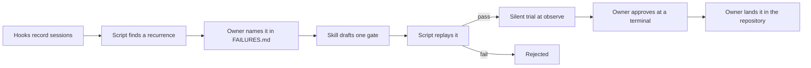
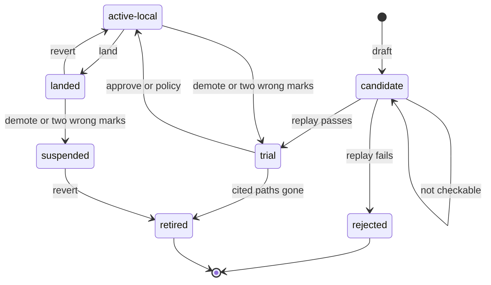

# The learning loop

How a tool failure that recurs across sessions becomes one small gate on
tool calls, and how that gate is promoted, landed, suspended, reverted or
retired. Plain code does every check. A model drafts, and only you approve.

[Back to the README](../../README.md) ·
[Command reference](commands.md#learn) ·
[Session log](session-log.md) ·
[Troubleshooting](troubleshooting.md)

## What a learning is

A learning is one gate plus a short title and reason, drafted by a model for
one recurrence. A gate is data, not code (rule R11):

| Key | Meaning |
|---|---|
| `tool` | the tool name the gate applies to, such as `Bash` |
| `field` | a dotted path to one string field of the tool's input, such as `command` |
| `match` | `{ "kind": "literal" \| "token" \| "glob", "value": "…" }` |
| `message` | one fixed line shown when the gate warns or blocks |
| `cites` | optional: up to ten repository paths the gate is about |
| `id`, `action` | assigned by the kit, never by the draft |

- `literal` matches a substring.
- `token` matches the value with a non-word character or the string's end on
  each side.
- `glob` matches the whole field, with `*` as its only wildcard; `?` is a
  literal character.

A value needs at least 3 characters that are neither `*` nor whitespace. A
gate inspects only the first 65536 characters of its field. A gate file
holds at most 100 gates. One hook, `tool-gate.mjs`, reads the committed
`.claude/kh-harness/gates.json` and this machine's `gates.local.json`
before every tool call. It builds no regular expression from gate data and
spawns nothing. Gates are tried in order of their number, and the first
that matches acts:

| Action | Effect |
|---|---|
| `observe` | records a firing in the session log; changes nothing |
| `warn` | the message reaches Claude alongside the tool's result, after the call has run |
| `block` | the call is denied, with the message as the reason |

## The steps, and who takes each

1. **The hooks** record each session, once you have run `log enable`.
2. **The script** finds recurrences: the same tool, input hash and
   normalised first error line in two or more sessions under the same kit
   hooks and model. `log report` and `learn candidates` list them.
3. **You** name the failure in `docs/harness/FAILURES.md`: a heading
   `## F<n> — <kind of failure>` and a line `- signatures: <signature>`.
4. **The `harness-learn` skill** reads `learn evidence`, writes one draft
   and runs `learn draft`. It drafts only for a recurrence you labelled.
5. **The script** replays the gate against the log (below).
6. **The gate hook** runs a passing gate at `observe`, which records each
   firing and blocks nothing.
7. **You**, at a terminal, approve its hash for `warn` or `block` on this
   machine — or **`tick`** promotes it under the policy you recorded.
8. **You**, at a terminal, land it in the repository and commit it.

## States and transitions

`retire` also leads to `retired` from the other live states, and is left out
of the diagram for clarity; the table below gives its conditions.

| From | To | Caused by | Who |
|---|---|---|---|
| — | `candidate` | `learn draft` | anyone; in practice the skill |
| `candidate` | `trial` | a replay that passes, from `draft` or `replay` | the script |
| `candidate` | `rejected` | a replay that fails | the script |
| `candidate` | `candidate` | a replay that is not checkable | the script |
| `trial` | `active-local` | `learn approve` | you, at a terminal |
| `trial` | `active-local` | `learn tick` under a recorded policy | `tick`, which anyone can run |
| `trial` | `retired` | `learn tick`, when every cited path is gone | `tick` |
| `active-local` | `trial` | `learn demote` | you, at a terminal |
| `active-local` | `trial` | the second wrong mark since its promotion | you mark it (terminal); `tick` finishes a demotion that did not happen |
| `active-local` | `landed` | `learn land --yes` | you, at a terminal |
| `landed` | `active-local` | `learn revert --yes` | you, at a terminal |
| `landed` | `suspended` | `learn demote`, or the second wrong mark since its landing | you, at a terminal; or `tick` |
| `suspended` | `retired` | `learn revert --yes` | you, at a terminal |
| `retired` | `retired` | `learn revert --yes`, for a learning retired while its gate was still committed: the gate is taken out | you, at a terminal |
| `candidate`, `trial`, `active-local` | `retired` | `learn retire` | you, at a terminal |
| `landed`, `suspended` | `retired` | `learn retire`, only once no gate of it is left in the committed gate file; while one is, retire is refused and names the revert | you, at a terminal |

The ledger, not a learning's own file, decides its status and the action its
gate may carry. Every step that writes first brings this machine's gate file
into line with the ledger. A gate the ledger does not grant is removed; one
it grants is restored while the ledger is intact. `rejected` and `retired`
are final, except that a revert can still take a retired learning's
committed gate out of the repository.

## Replay

Two checks, run by the script and never reported by the model:

- **Differential.** The gate fires on every recorded failure with the
  recurrence's signature in its sessions, and on none of the successful
  calls of the same tool that followed them.
- **False positives.** The gate fires on no call of its own tool in any
  session that holds no failure with that signature.

The false-positive check counts only calls whose inspected field is a string
the pattern was tested against. **It needs at least 20 such clean calls
across at least 2 sessions.** With fewer, the verdict is `not-checkable`
and the draft stays a candidate. So a fresh log returns `not-checkable` for
most drafts. Run `learn replay <id>` once the log holds more.

A call whose content retention has expired, or whose content was moved to a
blob, is counted as not replayable and never guessed at. The log is scrubbed
before it is written, so the gate is replayed against scrubbed text.

A replay that fails rejects the learning. That recurrence, and any other
that `FAILURES.md` labels with the same failure kind, is drafted again only
with `learn draft --redraft`, which the ledger records as a redraft. Which
recurrences a rejection covers follows the failure kinds as `FAILURES.md`
labels them now. The skill passes `--redraft` only when you ask for a new
draft in the conversation.

## Approval and the terminal check

> [!IMPORTANT]
> `approve`, `wrong`, `demote`, `retire`, `land`, `revert`, `policy set` and
> `policy clear` run only for a person at an interactive terminal outside
> Claude Code: standard input and output must both be terminals and
> `CLAUDECODE` must be unset. The built-in terminal of an IDE is refused,
> because the Claude Code extensions set `CLAUDECODE` there too. Use a
> separate terminal window. `land` and `revert` need it only with `--yes`;
> their dry run needs none and writes nothing.

To approve, run `learn show <id>`, read the gate, and pass the hash it
prints to `learn approve <id> --sha256 <hash> --action <warn|block>`. Any
change to the gate's content changes the hash and voids the approval.
`apply` also installs deny rules that make Claude Code decline these eight
subcommands, as a second barrier. The rules cover `land` and `revert` whole,
their dry runs included, so an agent cannot run even the dry run; you do.
The skill never runs any of the eight, nor `policy show`. Neither barrier is
isolation; see [Limits](../../README.md#limits).

## The policy

    node <kh-harness>/scripts/learn.mjs . policy set --min-firings 5 --min-sessions 3 --max-action warn

With a policy set, `tick` promotes, up to `--max-action`, each learning on
trial that was never demoted and has at least that many firings in at least
that many sessions, none marked wrong, and no evidence from a session that
read outside content. Both counts must be at least 1.

- A policy promotes on this machine only. It never lands a gate in the
  repository.
- `policy set` records the policy's hash in the ledger. A `policy.json` whose
  hash is not the one last recorded promotes nothing, so a file edited any
  other way stops promotion until you set it again.
- `policy clear` records the withdrawal; restoring an old file brings
  nothing back.
- Without a policy, nothing is promoted automatically.

The firings a policy counts come from the session log, which anything
running as you can append to. Your approval of a hash at a terminal is the
only control that does not depend on the log.

## tick

`learn tick` runs the rules that need no person: the repair, retiring
trials whose cited paths are all gone, demoting gates marked wrong twice,
and promoting under the policy. It never retires a gate that warns or
blocks. One promoted on this machine whose cited paths are all gone is
reported in `citationsGone`; a landed one is neither retired nor reported.
It runs when you or the `harness-learn` skill run it, never by itself. It
records when it ran in `last-tick.json`.

With `"autodraft": true` in the log's `config.json`, the start of a new
session (not a resumed or compacted one) tells the model, in one fixed
sentence, how many sessions were sealed since the last `tick`.

## Landing

`learn land <id>` writes a learning promoted on this machine into the
repository:

- its entry in `docs/harness/LEARNED.md`, a kit-owned file in the format of
  `RULES.md`;
- its gate, at the action you approved, in `.claude/kh-harness/gates.json`;
- a record of both in the manifest.

Without `--yes` it is a dry run: it shows the notes and the diff, needs no
terminal, and writes nothing in the repository or the data directory. With
`--yes`, at a terminal, it meets `apply`'s refusals: not on the default
branch, not on a dirty tree, unless `--allow-default-branch` or
`--allow-dirty` waives one. A `LEARNED.md` or `gates.json` that kh-harness
no longer owns stops it with exit 3. `RULES.md` is never written. The ledger
records you as the approver of the landing, whoever promoted the learning
here. The change is left uncommitted, and the command says so: review it
with `git status` and `git diff` and commit it. Only then does the gate
bind everyone who has the repository. `detect`'s `P5.integrity` checks that
every committed gate has an approved entry.

## Reverting

`learn revert <id>` takes the learning's gate, entry and manifest record out
of the repository, whichever are left; `--yes` at a terminal writes it, and
the dry run writes nothing.

- A landed learning returns to `active-local`. Its gate is written back to
  this machine's gate file first, so it never stops acting here, and its
  approval stands.
- A suspended learning ends `retired`.
- A learning retired while its gate was still committed is reverted too,
  and its gate taken out.
- A landed or suspended learning with no trace in this checkout, as after an
  uncommitted land was discarded, is reverted on this machine only: no file
  is written, and the dry run and the result say so.

Whenever the working tree's gate file no longer holds the learning's gate,
the revert reads the gate file in the commit `HEAD` names. If that commit
still holds the gate at the learning's hash, the gate is still committed for
everyone, so the revert goes on, and its first note says so: this run did
not remove the gate, it was already gone from the working tree, the commit
holds it until its removal is committed, and `git status` shows the files.
For a learning the revert retires, the note adds that restoring the file
from the commit puts the gate back in force on this machine. When the commit
cannot be read, or holds a gate file larger than the gate hook loads, the
notes say so and why. A revert that removes the gate itself needs no such
note.

A trace under the learning's id at another hash is refused, never removed.
A hand-edited learned file is never written; while it still holds the
learning, the refusal says that taking it out by hand lets the revert go on.

## Suspending

A landed gate judged wrong is suspended on this machine: by `learn demote`,
or by the second `learn wrong` mark since its landing (`tick` finishes a
demotion that did not happen). The committed gate then stops acting here
and still binds everyone else. The gate hook tells you once per session that
a suspension is in force. `learn revert <id> --yes` takes the gate out of
the repository and retires the learning. `learn retire` is refused while
the gate is still committed, since retiring writes no file, and the refusal
names the revert.

## Recovery from an interrupted land or revert

Each step's writes happen in a fixed order, so a stop at any point leaves a
state that the same command, run again, finishes or reports:

| Step | Order |
|---|---|
| land | `LEARNED.md`, then `gates.json`; the manifest; the ledger's `landed` entry, the learning file, and the removal of the local gate |
| revert | a landed learning's gate written back to the local gate file; `gates.json`, then `LEARNED.md`, when either holds a trace; the manifest, the record kept; the ledger's `reverted` (and `retired`, for a suspended learning or one retired with its gate still committed) entries, then the learning file; the manifest record dropped, when there was one |

Run the same command again and it finishes:

- **A kill between a file write and the manifest write.** The file on disk
  is recognised when it is exactly what this step makes from the file the
  manifest records (or from no file, where it records none). The step goes
  on from the recorded file and records the one on disk. Any other
  difference is a hand edit, and is refused.
- **A land stopped before its ledger entry** finds every file already as it
  would write them. One stopped between its `landed` entry and the learning
  file is recognised from the ledger. A revert of such a learning says that
  running the land again finishes it.
- **A revert** keeps the manifest record until its ledger entries are
  written, so a trace is always left for the next revert. One whose entries
  are written in part or whole, its learning file not yet, is recognised
  from the ledger's last entries for the learning, and only what is missing
  is written. A record left once every entry is written is removed by the
  next revert, whatever the learning's status has become since.

A committed gate never stands without its registry entry. At worst an entry
approves a gate not yet written, or is left for a gate already removed, and
`P5.integrity` reports either as failing until the step is finished.

After a branch switch to a checkout without the committed gate, or once an
uncommitted land is discarded, a landed learning is enforced nowhere until
the next `learn` command or `tick` writes its local gate back. A revert then
returns it to `active-local` on this machine.
