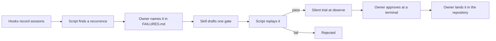
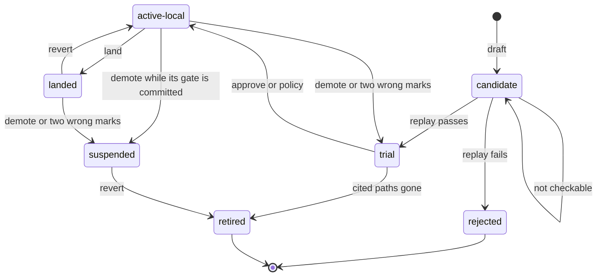

# The learning loop

How a tool failure that recurs across sessions becomes one small gate on
tool calls, and how that gate is promoted, landed, suspended, reverted or
retired. Plain code does every check. A model drafts. The kit's commands
move a gate past `observe` in two ways: `learn approve`, which runs only at
an interactive terminal outside Claude Code, and `tick` under a policy
whose hash the ledger records. A process running as you can forge either,
and a gate that reaches a gate file some other way (a teammate's commit, a
hand edit) acts as soon as it is there; see
[Limits](../../README.md#limits).

[Back to the README](../../README.md) ·
[Command reference](commands.md#learn) ·
[Session log](session-log.md) ·
[Troubleshooting](troubleshooting.md)

## What a learning is

A learning is one gate plus a short title and reason, drafted by a model for
one recurrence. A gate is data, not code (rule R11):

| Key | Meaning |
|---|---|
| `tool` | the tool name the gate applies to, such as `Bash` |
| `field` | a dotted path to one string field of the tool's input, such as `command` |
| `match` | `{ "kind": "literal" \| "token" \| "glob", "value": "…" }` |
| `message` | one fixed line shown when the gate warns or blocks |
| `cites` | optional: up to ten repository paths the gate is about |
| `id`, `action` | assigned by the kit, never by the draft |

- `literal` matches a substring.
- `token` matches the value with a non-word character or the string's end on
  each side.
- `glob` matches the whole field, with `*` as its only wildcard; `?` is a
  literal character.

A value needs at least 3 characters that are neither `*` nor whitespace. A
gate inspects only the first 65536 characters of its field. A gate file
holds at most 100 gates. A message that the credential mask would change is
rejected. One hook, `tool-gate.mjs`, reads the committed
`.claude/kh-harness/gates.json` and this machine's `gates.local.json`
before every tool call. It builds no regular expression from gate data and
spawns nothing. Every gate in force is tried against the call, and each
one that matches acts:

| Action | Effect |
|---|---|
| `observe` | records a firing in the session log; changes nothing |
| `warn` | the message reaches Claude alongside the tool's result, after the call has run |
| `block` | the call is denied, with the message as the reason |

- The call is denied when any matching gate blocks.
- The text Claude gets names each matching gate above `observe` on a line
  of its own, `kh-harness gate <id>: <message>`, the blocks first and then
  the warnings, each in ascending order of the id's number. So a denial
  also carries the messages of the gates that only warn.
- That text is capped at 4,000 characters; a last line counts the matching
  gates not shown.
- Every match records a firing with its own action and the agent that made
  the call, a gate not shown included, so no gate hides another. A gate's
  number decides only the order of the lines.
- A firing is recorded only while the session log is enabled; with the log
  disabled an `observe` gate does nothing.

The hook checks no approval: it enforces whatever the two gate files hold.

## The steps, and who takes each

1. **The hooks** record each session, once you have run `log enable`.
2. **The script** finds recurrences: the same tool, input hash and
   normalised first error line in two or more sessions under the same kit
   hooks and model. `log report` and `learn candidates` list them.
3. **You** name the failure in `docs/harness/FAILURES.md`: a heading
   `## F<n> — <kind of failure>` and a line `- signatures: <signature>`.
4. **The `harness-learn` skill** reads `learn evidence`, writes one draft
   and runs `learn draft`. It drafts only for a recurrence you labelled,
   and so does the command: `learn draft` refuses a signature that no
   failure kind lists, and refuses while `FAILURES.md` could not be read.
5. **The script** replays the gate against the log (below).
6. **The gate hook** runs a passing gate at `observe`, which records each
   firing and blocks nothing.
7. **You** run `learn approve` with its hash, for `warn` or `block` on this
   machine; the command runs only at an interactive terminal outside Claude
   Code. Or **`tick`** promotes it under a policy whose hash the ledger
   records.
8. **You** run `learn land --yes`, which also needs that terminal, and
   commit the change.

## States and transitions

`retire` also leads to `retired` from the other live states, and is left out
of the diagram for clarity; the table below gives its conditions.

| From | To | Caused by | Terminal check |
|---|---|---|---|
| — | `candidate` | `learn draft` | none; in practice the skill runs it |
| `candidate` | `trial` | a replay that passes, from `draft` or `replay` | none: the script decides |
| `candidate` | `rejected` | a replay that fails | none: the script decides |
| `candidate` | `candidate` | a replay that is not checkable | none: the script decides |
| `trial` | `active-local` | `learn approve` | an interactive terminal outside Claude Code |
| `trial` | `active-local` | `learn tick` under a recorded policy | none at the terminal; the policy file's hash must equal the last policy hash the ledger records |
| `trial` | `retired` | `learn tick`, when every cited path is gone | none |
| `active-local` | `trial` | `learn demote`, or the second wrong mark since its promotion, while its gate is not in the committed gate file | an interactive terminal outside Claude Code (`learn demote`, `learn wrong`); `tick`, which has none, finishes a demotion that did not happen |
| `active-local` | `suspended` | the same, while its gate is in the committed gate file (a land that stopped before its ledger entry, or a checkout that already holds it) | an interactive terminal outside Claude Code for `demote` and `wrong`; none for `tick` |
| `active-local` | `landed` | `learn land --yes` | an interactive terminal outside Claude Code |
| `landed` | `active-local` | `learn revert --yes` | an interactive terminal outside Claude Code |
| `landed` | `suspended` | `learn demote`, or the second wrong mark since its landing | an interactive terminal outside Claude Code for `demote` and `wrong`; none for `tick` |
| `suspended` | `retired` | `learn revert --yes` | an interactive terminal outside Claude Code |
| `retired` | `retired` | `learn revert --yes`, for a learning retired while its gate was still committed: the gate is taken out | an interactive terminal outside Claude Code |
| `candidate`, `trial`, `active-local` | `retired` | `learn retire` | an interactive terminal outside Claude Code |
| `landed`, `suspended` | `retired` | `learn retire`, only once no gate of it is left in the committed gate file; while one is, retire is refused and names the revert | an interactive terminal outside Claude Code |

The ledger, not a learning's own file, decides its status, the action its
gate may carry, and its content. Two hashes bind the content: one of the
gate, and one of the title, why, evidence and outside-content flag. Every
status-changing entry carries both, and a learning whose file differs from
either is not vouched for. The chain has no key, so this shows a file that
no longer matches the ledger, not who wrote the ledger.

Every step that writes first brings this machine's gate file into line
with the ledger. A gate the ledger does not grant is removed; one it grants
is restored while the ledger is intact. `rejected` and `retired` are final,
except that a revert can still take a retired learning's committed gate
out of the repository, and that the recurrence can be drafted again as a
new learning (see [Replay](#replay)).

**A step that stopped.** Each transition is written ledger first, then the
learning file, then the local gate file. A learning file left behind its
ledger entry is rolled forward by the same command run again, by any step
that writes, or by `tick`: when the file's gate is the one the last status
entry names, its status, action and evidence are rewritten from that
entry, with an action above `observe` only where the entry names an
approver. A rolled-forward learning shows its replay's verdict and reason
without the counts, which no ledger entry holds. Two kinds are left to
their own command: a `landed` or `reverted` entry is finished by
`learn land` or `learn revert`, since each is half of a change to the
repository; each finishes its own stopped step only when the ledger
vouches for the file as that entry leaves it, title, why and evidence
included, and refuses (3) a file whose text was changed since. A learning
the ledger names that has no file at all is
recorded retired by `tick` only when the ledger last records it at
`observe` and no entry for it names an approver, after which its
recurrence can be drafted again; any other is reported and left as the
ledger has it, so the file put back is the learning it was.

**A learning drafted before the second hash.** Its ledger entries carry no
hash of the title, why and evidence. Its gate, status and action are
vouched for as before. `learn list` and `learn show` name it, and a policy
does not promote it. The hash is recorded by the first step at which the
same run prints that text at a terminal: `learn approve`, which prints the
learning, or `learn land --yes`, which prints the diff it writes. Once any
status entry for a learning records the hash, a later status entry without
it vouches for nothing.

**Ids are per machine.** A landing pulled from another machine can hold the
id of a local learning. The gate hook then applies the committed gate under
that id and ignores the local one. `learn list`, `learn show` and
`learn tick` report it; nothing renumbers a learning. Retire the local
learning at a terminal and draft its recurrence again with `--redraft`.

## Replay

Two checks, run by the script and never reported by the model:

- **Differential.** The gate fires on every recorded failure with the
  recurrence's signature in its sessions, and on none of the successful
  calls of the gate's tool in those sessions, wherever in the session they
  fall. There must be at least one such successful call.
- **False positives.** The gate fires on no call of its own tool in any
  session that holds no failure with that signature.

The false-positive check counts only calls whose inspected field is a string
the pattern was tested against. **It needs at least 20 such clean calls
across at least 2 sessions.** With fewer, the verdict is `not-checkable`
and the draft stays a candidate. The verdict is also `not-checkable`, never
a pass, when the recurrence's own sessions record no successful call of
the gate's tool, when a recorded mistake or good call could not be
replayed, or when one of those sessions could not be read in full. So a
fresh log returns `not-checkable` for most drafts. Run `learn replay <id>`
once the log holds more.

A call whose content retention has expired, or whose content was moved to a
blob, is counted as not replayable and never guessed at. The log is scrubbed
before it is written, so the gate is replayed against scrubbed text.

A replay that fails rejects the learning. That recurrence, and any other
that `FAILURES.md` labels with the same failure kind, is drafted again only
with `learn draft --redraft`, which the ledger records as a redraft. The
same holds for a recurrence whose earlier learning was retired after a
wrong mark, after its gate was suspended, or by the owner's `retire`. A
trial that `tick` retired because its cited paths were gone leaves its
recurrence draftable. Which recurrences an earlier learning covers follows
the failure kinds as `FAILURES.md` labels them now. `learn candidates`
lists these recurrences apart, each with the earlier learning and how it
ended. The skill passes `--redraft` only when you ask for a new draft in
the conversation.

## The terminal check and the deny rules

This is the one place these two barriers are described; the other pages
link here.

> [!IMPORTANT]
> Eight `learn` subcommands are terminal-only: `approve`, `wrong`, `demote`,
> `retire`, `land`, `revert`, `policy set` and `policy clear`. So is
> `log purge --yes`, which deletes the ledger, the learnings, the policy
> and this machine's gate file. Each runs only when its standard input and
> output are both terminals and `CLAUDECODE` is unset. Nothing checks that
> a person is at that terminal.

**The terminal check.** Standard input and standard output must both be
terminals, and `CLAUDECODE` must be unset. The check relies on what
`scripts/lib/tty.mjs` records from the Claude Code environment-variable
reference (read 2026-11-19): Claude Code sets `CLAUDECODE` in the
subprocesses it spawns, and IDE extensions set it in their integrated
terminals. So a command Claude Code runs, or one typed in an IDE's
built-in terminal, is refused; use a separate terminal window. Run
anywhere else, or with either stream redirected, a terminal-only
subcommand exits 3, and its refusal says what is checked:

    approve refused: standard input is not an interactive terminal; it runs only from an interactive terminal outside Claude Code (standard input and output both terminals, CLAUDECODE unset), and nothing was changed.

It changes no learning, but it first runs the gate repair, which can
rewrite this machine's `gates.local.json`. `land` and `revert` need the
terminal only with `--yes`: without it each is a dry run that writes
nothing, and anyone may run it. `log purge` likewise needs it only with
`--yes`. No flag or variable skips the check.

**The deny rules.** `apply` installs, beside the gate hook, Bash and
PowerShell deny rules over `learn.mjs` for all eight, so Claude Code
declines to run them: a second barrier. Each rule matches the text
`learn.mjs` followed, after a space, by one of the subcommand words. The
rules cover `land` and `revert` whole, their dry runs included, by design:
the dry run is yours to read. A command that reaches the script another
way, through a package script or with the subcommand quoted, is not caught
by them, and only the terminal check stops it. An unrelated command that
holds that text, such as a commit message, is declined too. An install made
before a rule existed is proposed the ones it lacks by the next `apply`.

Four more rules deny `log purge --yes`, in the Bash and PowerShell tools,
with `--yes` after `purge` or before it:

    Bash(*log.mjs* purge*--yes*)
    Bash(*log.mjs*--yes* purge*)
    PowerShell(*log.mjs* purge*--yes*)
    PowerShell(*log.mjs*--yes* purge*)

`log purge` without `--yes`, and the other `log` subcommands, are not
denied.

**The skill.** `harness-learn` runs none of the eight, not even the dry
runs of `land` and `revert`, and not `policy show`.

Neither barrier is isolation: a process running as you can forge a terminal
and clear `CLAUDECODE`, or call the kit's functions from Node directly. See
[Limits](../../README.md#limits).

## Approval

Run `learn show <id>`, read the gate, and pass the hash it prints to
`learn approve <id> --sha256 <hash> --action <warn|block>`, at a terminal.
Any change to the gate's content changes the hash and voids the approval.
`approve` prints the learning first, so the hash approved sits beside the
title, why and gate it covers; a learning whose title, why or evidence no
longer matches the ledger's second hash is refused (exit 3) like one whose
gate changed.

`learn show <id>` also lists the gate's latest ten firings, each as the
`<session>:<line>` reference that `learn wrong` takes, and says how many
earlier ones there are; `learn show <id> --firings` lists every one. To mark
a firing wrong, pass its reference: `learn wrong trial-1:15`, at a terminal.

## The policy

    node <kh-harness>/scripts/learn.mjs . policy set --min-firings 5 --min-sessions 3 --max-action warn

With a policy set, `tick` promotes, up to `--max-action`, each learning on
trial that was never demoted and has at least that many firings in at least
that many sessions. A firing in a session that read outside content is not
counted. Both counts must be at least 1. It promotes none of these:

- a learning marked wrong;
- one with outside content behind its recurrence, judged from the log as it
  stands at that tick;
- one whose recurrence or failure kind an earlier learning was marked wrong
  for;
- one whose title, why and evidence the ledger records no hash of;
- any trial at all, while `docs/harness/FAILURES.md` could not be read or
  is over 1 MiB, since the wrong-mark rule cannot then be applied.

For the last three, `tick` lists the trial with the reason under
`trials the policy passed over`.

- A policy promotes on this machine only. It never lands a gate in the
  repository.
- `policy set` records the policy's hash in the ledger. A `policy.json` whose
  hash is not the one last recorded promotes nothing, so a file edited any
  other way stops promotion until you set it again.
- `policy clear` records the withdrawal; restoring an old file brings
  nothing back.
- Without a policy, nothing is promoted automatically.

The firings a policy counts come from the session log, which anything
running as you can append to. An approval with `learn approve` does not
depend on the log's firing counts, but it is a ledger entry like any
other, and a process running as you can forge it too.

## tick

`learn tick` runs the rules that need no person: rolling forward a learning
file a stopped step left behind the ledger, recording as retired a
learning the ledger names that has no file left, the repair, retiring
trials whose cited paths are all gone, demoting gates marked wrong twice,
and promoting under the policy. It never retires a gate that warns or
blocks. One promoted on this machine whose cited paths are all gone is
reported in `citationsGone`; a landed one is neither retired nor reported.
It runs when you or the `harness-learn` skill run it, never by itself. It
records when it ran in `last-tick.json`.

With `"autodraft": true` in the log's `config.json`, the start of a new
session (not a resumed or compacted one) tells the model, in one fixed
sentence, how many sessions were sealed since the last `tick`.

## Landing

`learn land <id>` writes a learning promoted on this machine into the
repository:

- its entry in `docs/harness/LEARNED.md`, a kit-owned file in the format of
  `RULES.md`. The entry records the gate's hash (`- approved-sha256:`) and,
  on a line of its own, the action it was approved at
  (`- approved-action: warn` or `block`);
- its gate, at the action its approval recorded, in `.claude/kh-harness/gates.json`;
- a record of both in the manifest.

Without `--yes` it is a dry run: it shows the notes and the diff, needs no
terminal, and writes nothing in the repository or the data directory. With
`--yes`, at a terminal, it meets `apply`'s refusals: not on the default
branch, not on a dirty tree, unless `--allow-default-branch` or
`--allow-dirty` waives one. A `LEARNED.md` or `gates.json` that kh-harness
no longer owns stops it with exit 3. `RULES.md` is never written. The ledger
records `approvedBy: 'owner'` for the landing, whoever promoted the learning
here. The change is left uncommitted, and the command says so: review it
with `git status` and `git diff` and commit it. Only then does the gate
bind everyone who has the repository. `land --yes` prints the same diffs as
the dry run, made from the files it then writes, before it says what it
wrote.

`detect`'s `P5.integrity` compares every committed gate with its entry:
the gate's hash against `approved-sha256`, and its action against
`approved-action`. It cannot see a hand edit that changes the gate file
and the entry together. An entry landed before entries recorded the action
has no `approved-action` line; `detect` reports its gate as
`not approved for its action`, and `learn revert <id> --yes` then
`learn land <id> --yes`, at a terminal on the machine that landed it,
writes one.

The prompt hook reads the same line. A learned rule is re-told on every
prompt, within the rules brief's byte bound, unless its entry says
`enforced-by: hook` and `approved-action: block`: a gate that blocks holds
the rule already. One that warns, and one whose entry has no
`approved-action` line, is re-told, and `detect` counts it among the rules
injected.

## Reverting

`learn revert <id>` takes the learning's gate, entry and manifest record out
of the repository, whichever are left; `--yes` at a terminal writes it, and
the dry run writes nothing. What it does in each case, and what to type
after a land or revert that stopped, is in the table under
[Recovery and every revert case](#recovery-and-every-revert-case).

## Suspending

A landed gate judged wrong is suspended on this machine: by `learn demote`,
or by the second `learn wrong` mark since its landing (`tick` finishes a
demotion that did not happen). The committed gate then stops acting here
and still binds everyone else. The gate hook tells you once per session that
a suspension is in force. `learn revert <id> --yes` takes the gate out of
the repository and retires the learning. `learn retire` is refused while
the gate is still committed, since retiring writes no file, and the refusal
names the revert.

## Recovery and every revert case

Each step writes in a fixed order — a land writes `LEARNED.md`, then
`gates.json`, the manifest, its ledger entry, the learning file, and last
removes the local gate; a revert first writes a landed learning's gate back
to the local gate file, and keeps the manifest record until its ledger
entries are written — so a step that stops leaves a state the same command
finishes. A committed gate never stands without its registry entry; until a
stopped step is finished, `P5.integrity` reports what it left as failing.

| Situation | Type, at a terminal | Result |
|---|---|---|
| A landed learning, its gate and entry in the working tree | `learn revert <id> --yes` | Gate, entry and manifest record removed; the learning is `active-local` again, its gate written back to this machine first, its approval standing. Commit the change. |
| A suspended learning | `learn revert <id> --yes` | Gate, entry and record removed; the learning is retired. |
| A learning retired while its gate was still committed | `learn revert <id> --yes` | The gate is taken out; the ledger records `reverted` and `retired` again. |
| A landed or suspended learning with nothing of it in this checkout (an uncommitted land discarded) | `learn revert <id> --yes` | Reverted on this machine only; no file is written, and the dry run and the result say so. |
| The working tree's `gates.json` no longer holds the gate, and the commit `HEAD` names still does | `learn revert <id> --yes` | It goes on. Its first note says this run did not remove the gate, the commit still holds it until its removal is committed, and `git status` shows the files; for a learning it retires, that restoring the file from the commit puts the gate back in force here. |
| The same, and the commit cannot be read, or holds a gate file larger than the hook loads | `learn revert <id> --yes` | It goes on; the notes say why the commit could not be checked. |
| A land or revert killed between a file write and the manifest write | the same command again | The file on disk is recognised as that step's own write (exactly what it makes from the recorded file) and the step finishes. Any other difference is a hand edit and is refused. |
| A land stopped before its ledger entry, or between that entry and the learning file | `learn land <id> --yes` | Every file is found as it would write it, and the land finishes. A revert of such a learning says to run the land again. |
| A revert stopped after part or all of its ledger entries | `learn revert <id> --yes` | Recognised from the ledger's last entries; only what is missing is written, and a manifest record left behind is removed. |
| A learned file edited by hand, still holding the learning | restore it from git, or take the learning out of it by hand, then `learn revert <id> --yes` | Refused (exit 3) until then; the refusal says both ways. |
| A step other than land or revert that stopped after its ledger entry (a replay, an approval, a demotion, a retirement) | the same command again, or `learn tick` | The learning file is rolled forward from the ledger first. The same command then refuses (exit 3), since the learning is already in the new status, and says the file was brought into line. |
| A learning the ledger names whose file is gone | `learn tick` | Recorded retired when the ledger last records it at `observe` and names no approver for it, and its recurrence can be drafted again. Any other is listed under `NOT DONE` and left as it is: restore the file. |
| A local learning whose id a pulled landing also uses | `learn retire <id>`, then draft again with `--redraft` | `list`, `show` and `tick` report it until then; the committed gate is the one applied. |
| The ledger's last line is unterminated (an append that stopped partway) | nothing | Every reader passes over it, and the next append removes it. |
| A gate, entry or record under the same id at another hash | — | Refused, never removed: it is not this learning's. |
| A branch switch to a checkout without the committed gate | any writing `learn` command, or `learn tick` | The landed learning's gate is enforced nowhere until then; the repair writes it back to this machine. |
